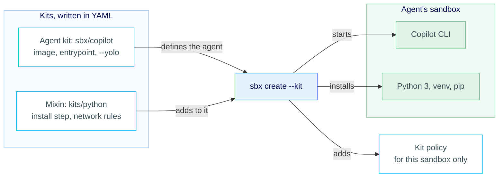

# 🧩 Kits

Every agent you'll run in this lab comes from a **kit**. A kit is a declarative YAML artifact, published to a registry like an image, that describes an agent's sandbox: which image runs, how the agent starts, and what it is given (credentials, network policies, environment variables, startup commands and files).

Because all of that lives in one versioned artifact, the agent's environment, and the authority it gets, is reproducible and reviewable: a change in what an agent is allowed to do shows up as a change in its kit.

There are two kinds of kits:

| Kind | What it does | Example |
|------|--------------|---------|
| Agent kit (`kind: sandbox`) | Defines the agent: its image, entrypoint, default arguments, and what it needs | `sbx/copilot`, `sbx/claude` |
| Mixin | Extends an agent kit with a tool, a credential, a network rule, a file… | Added with `sbx create <agent> --kit <reference>` |



Run the commands of this module from the root of the repository.

## Inspect the Copilot kit

1. Show a summary of the kit that `sbx run copilot` uses:

    ```bash
    sbx kit inspect sbx/copilot
    ```

    ```none
      Name:         copilot
      Kind:         sandbox
      Schema:       v3
      Display:      GitHub Copilot
      Description:  GitHub Copilot CLI, GitHub's agentic coding CLI.
      Binary:       copilot
      Template:     docker.io/sbx/copilot@sha256:f9c2331f...
      Run Options:  --yolo
      Policies:     none
    ```

2. Show the kit's declaration itself:

    ```bash
    sbx kit inspect sbx/copilot --format yaml
    ```

    ```yaml
    schemaVersion: "3"
    kind: sandbox
    name: copilot
    displayName: GitHub Copilot
    description: GitHub Copilot CLI, GitHub's agentic coding CLI.
    sourceURL: https://github.com/docker-hardened-images/definitions
    sandbox:
      image: docker.io/sbx/copilot@sha256:f9c2331f...
      entrypoint:
      - copilot
      command:
        default:
        - --yolo
    ```

It's a small file, and it tells you a lot about the sandboxes you'll use in this lab:

| In the kit | What it means | Where you'll see it |
|------------|---------------|---------------------|
| `sandbox.image`, pinned by digest, built from Docker Hardened Images (`sourceURL`) | The sandbox's image: a minimal Debian image with the `agent` user and Docker, but no Python | [Agent sandbox](04-first-sandbox.md): you add Python with the kit you build below |
| `entrypoint: copilot` | `sbx run` starts the Copilot CLI | [Agent sandbox](04-first-sandbox.md) |
| `command.default: --yolo` | Copilot runs without asking for confirmations; arguments you pass after `--` are added to it | [Agent sandbox](04-first-sandbox.md), [Clone mode and parallel agents](07-parallel-agents.md) |
| No policies (`Policies: none`) | The descriptor declares no network rules. `sbx` still allows Copilot's own core hosts for each Copilot sandbox, on top of the rules you added in [Network policies](01-network-policies.md) | [Agent sandbox](04-first-sandbox.md), with `sbx policy ls` |

## Compare with another agent kit

Kits describe every agent the same way. Inspect the Claude Code kit:

```bash
sbx kit inspect sbx/claude
```

It uses more of the format than the Copilot kit:

- **Arguments** (`model`, `reasoningEffort`): settings you can choose when you create a sandbox, with `--kit-arg model=...`.
- **Environment variables** (`Policies: Environment: 2 variables`), set inside the sandbox.
- An **AI file** (`/home/agent/.claude/CLAUDE.md`), where context for the agent is placed.

## Build your own kit

Writing a kit is mostly writing YAML. The DevBoard project includes a small mixin, [`project/kits/python/python.yaml`](../project/kits/python/python.yaml), that adds Python to an agent's sandbox, so your agent doesn't have to install it by hand.

```yaml
# syntax=docker/sandbox-kit:3
schemaVersion: "3"
kind: mixin
displayName: Python
description: Python 3 with venv and pip, installed when the sandbox is created

capabilities:
  # Install Python once, as root, when the sandbox is created.
  - type: com.docker.sandbox/lifecycle@1
    config:
      install:
        - description: Install Python 3, venv and pip
          user: "0"
          command: apt-get update && apt-get install -y --no-install-recommends python3 python3-venv python3-pip

  # Only the hosts this kit needs. While installing: the sandbox image's apt
  # repositories (Debian and Docker Hardened Images), which apt-get update reads.
  # Afterwards: PyPI, for pip.
  - type: com.docker.sandbox/network-policy@1
    config:
      install:
        allow: [deb.debian.org, dhi.io]
      runtime:
        allow: [pypi.org, files.pythonhosted.org]
```

It declares two capabilities: a **lifecycle** hook that runs once when the sandbox is created, and a **network policy** that opens only the hosts this kit needs. While installing, that's the sandbox image's apt repositories, `deb.debian.org` and `dhi.io` (Docker Hardened Images), because `apt-get update` reads every configured source. Afterwards, it's PyPI for `pip`. No Dockerfile is needed for this one.

1. Check that the kit is valid:

    ```bash
    sbx kit validate ./project/kits/python
    ```

    ```none
      ✓ ./project/kits/python — valid (directory)
    ```

2. See what it declares:

    ```bash
    sbx kit inspect ./project/kits/python
    ```

    ```none
      Name:         python
      Kind:         mixin
      Schema:       v3
      Display:      Python
      Description:  Python 3 with venv and pip, installed when the sandbox is created
      Policies:
        Network:    2 allow, 0 deny
        Commands:   1 install, 0 startup, 0 init files
    ```

You'll use this kit to create the sandboxes your agents work in, in [Agent sandbox](04-first-sandbox.md) and [Clone mode and parallel agents](07-parallel-agents.md).

To share a kit, publish it in a Git repository or an OCI registry (`sbx kit push`). Remote kits are only installed from trusted publishers: `sbx` checks each reference against the `kit.allowedSources` setting (see `sbx settings get kit.allowedSources`). For example, if you published this kit in your own GitHub repository, someone using it as `--kit "git+https://github.com/<YOUR-GITHUB-USERNAME>/<REPOSITORY>.git#dir=kits/python"` must first allow `github.com/<YOUR-GITHUB-USERNAME>/` there.

The next two sections show two more ways to package what you just did. They're here so you know they exist: you don't need to run them, and the rest of the lab doesn't use them.

## Combine kits into a kit set

In this lab you add the Python mixin to the Copilot kit with `--kit` each time you create a sandbox. A [kit set](https://docs.docker.com/ai/sandboxes/customize/author/kit-sets/) (Early Access) packages that combination as a single kit, so your team runs one reference, with the versions you chose:

```yaml
# syntax=docker/sandbox-kit:3
schemaVersion: "3"
kind: set
displayName: Copilot with Python
version: "1.0.0"

kits:
  - ref: docker.io/sbx/copilot@sha256:<DIGEST>          # the agent kit you inspected above
  - ref: docker.io/<NAMESPACE>/python-kit:1.0.0         # the Python mixin, once published
```

- A set lists its components under `kits:`: at most one agent kit (a workload) and any number of mixins.
- Every component must be **published** to a registry. Local paths such as `./kits/python` aren't accepted, so you'd publish the Python mixin first.
- Each component keeps its own network rules and credential requests. The set only adds what the combination needs on top, with the same `capabilities:` as a mixin.
- You build and publish a set with Docker Buildx, `docker buildx build ./copilot-python -f ./copilot-python/copilot-python.yaml -t docker.io/<NAMESPACE>/copilot-python:1.0.0 --push`, then run it like any agent: `sbx run docker.io/<NAMESPACE>/copilot-python:1.0.0 --name quickstart`. No `--kit` needed.

## Describe a sandbox in an environment file

A kit packages tools. An [environment file](https://docs.docker.com/ai/sandboxes/configuration/environment-files/) (`sbxenv.yaml`, experimental) describes a whole sandbox instead: the agent and its kits, the workspace, the secrets, the published ports, MCP servers, and commands to run on your host. Commit it with the project, and every contributor gets the same sandbox without retyping flags.

This file, at the root of the repository, gathers the setup you'll do step by step in the next modules:

```yaml
schemaVersion: "1"
name: quickstart
agent: copilot
workspace: ./project          # the folder shared with the sandbox (module 04)

kits:
  - ./project/kits/python     # the Python mixin from this module

secrets:                      # the GitHub token (module 03), stored for this sandbox only
  github:
    command: gh auth token
  copilot:
    command: gh auth token

ports:                        # the published ports (module 09)
  - sandbox: 8000
    host: 8000
  - sandbox: 3000
    host: 3001
```

- `sbx env plan` shows what the file would create, without applying anything. `sbx env run` creates the sandbox if needed, after you approve the plan, then attaches to the agent. `sbx env rm` removes it.
- Paths are relative to the file. Keep the file **outside** the workspace: it declares commands that run on your host, such as `gh auth token`, and the agent must not be able to change them.
- Unlike a [kit's port](09-port-forwarding.md#publish-a-port-from-a-kit), an environment file can choose the host port, because it belongs to your project rather than being shared like a kit.

## Going further

- **Extend an agent with a mixin**: `sbx run copilot --kit ./my-mixin/`. A mixin can come from a local directory, a ZIP file, a Git repository or an OCI registry.
- **Share your kits**: `sbx kit push` and `sbx kit pull` (OCI registries), and `sbx kit sign` and `sbx kit verify` to sign and check them.
- Read the [Docker Sandbox Kit specification](https://github.com/docker/sandbox-kit-spec) to see everything a kit can declare.

[[<< Previous: Network policies](01-network-policies.md) | [Next >> Secrets and credentials](03-secrets-credentials.md)]
