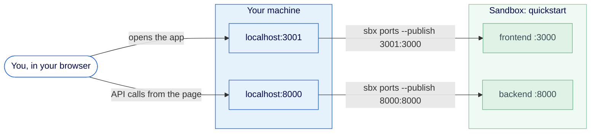

# ☎️ Port forwarding with `sbx ports`

Sandboxes are network-isolated: your browser can't reach a server running inside one by default. `sbx ports` publishes a sandbox port on a host port.



## Forward the API

1. With the Docker Compose stack from the previous module still running (the `quickstart` sandbox must be running: see `sbx ls`), run the following in a terminal on your host:

    ```bash
    sbx ports quickstart --publish 8000:8000
    ```

    You should see `Published 127.0.0.1:8000 -> 8000/tcp4`.

2. Open [http://localhost:8000/docs](http://localhost:8000/docs) to see the live Swagger UI served from inside the sandbox.

## Forward the frontend

1. Publish the sandbox's port 3000 on port 3001 of your host to reach the frontend:

    ```bash
    sbx ports quickstart --publish 3001:3000
    ```

    The syntax is `HOST_PORT:SANDBOX_PORT`. Port 3001 is used here to show that the two ports don't have to match.

2. Open [http://localhost:3001](http://localhost:3001) in your browser to see the DevBoard web front end. Click **Register** to create an account, then create a project and a few issues.

> [!NOTE]
> The browser calls the API directly at `http://localhost:8000`, which is why the API port must be published on the same port number, and why the API accepts requests from `http://localhost:3001`.

## Additional commands

1. To list the ports published by a sandbox, run `sbx ports` with the sandbox name:

    ```bash
    sbx ports quickstart
    ```

    The output looks similar to this:

    ```console
    HOST IP     HOST PORT   SANDBOX PORT   PROTOCOL
    127.0.0.1   3001        3000           tcp4
    127.0.0.1   8000        8000           tcp4
    ```

2. To stop publishing a port, use the `--unpublish` flag:

    ```bash
    sbx ports quickstart --unpublish 8000:8000
    ```

> [!IMPORTANT]
> Services inside the sandbox must listen on `0.0.0.0`, not `127.0.0.1`. Many development servers default to `127.0.0.1`, which is why the prompt in the previous module explicitly asks the agent to bind to `0.0.0.0`.

> [!IMPORTANT]
> Ports are only reachable while the sandbox is running. A sandbox stops when no agent session is attached, so keep your agent session open, or start it without a session with `sbx run --detach --name quickstart`. Published ports are restored when the sandbox restarts.

[[<< Previous: Docker inside the sandbox](08-docker-inside-the-sandbox.md) | [Next >> MCP servers](10-mcp-servers.md)]
