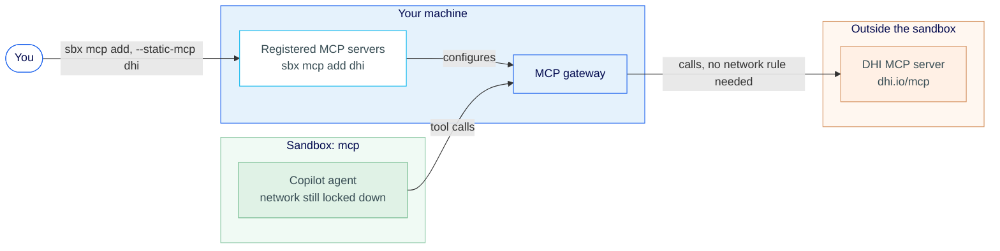

# 🧰 Give your agent tools with MCP

Your agent can only reach the hosts you allowed in the [network policies](01-network-policies.md) module. Sometimes it needs a capability rather than a website: that's what [MCP](https://modelcontextprotocol.io/) (Model Context Protocol) servers provide.

Each sandbox has an **MCP gateway**. The agent only talks to the gateway; the MCP servers you register run **outside** the sandbox, on your host or as remote services. You give the agent new tools without opening its network.

In this module you give your agent the **Docker Hardened Images (DHI)** MCP server, so it can look up a hardened alternative to an image DevBoard uses.



1. Register the DHI MCP server, from a terminal on your host:

    ```bash
    sbx mcp add dhi --url https://dhi.io/mcp
    ```

    If a browser window opens, sign in with your Docker account to authorize it.

2. Check that it's registered and ready:

    ```bash
    sbx mcp ls
    ```

    ```none
    NAME   TRANSPORT     STATUS   GATEWAY                 DETAIL
    dhi    remote http   ready    LOCAL, managed by you
    ```

3. From the `project` directory, create a dedicated sandbox named `mcp`, with the DHI server:

    ```bash
    sbx create --name mcp --static-mcp dhi copilot .
    ```

    `--static-mcp dhi` starts the sandbox's MCP gateway with **exactly this server**, and without the discovery tools an agent could use to find and add servers by itself. You decide which servers it gets.

4. Start an agent in the `mcp` sandbox:

    ```bash
    sbx run --name mcp
    ```

    Then give it this prompt:

    ```console
    For both the frontend and the backend app, from their Dockerfiles, find the Docker Hardened Image that matches it and how many known CVEs it has. At the end, list the tools you called.
    ```

    The agent reads both Dockerfiles, calls `dhi` tools such as `dhi_get_repository`, and suggests `dhi.io/python:3.12` for the backend and `dhi.io/node:22-alpine` for the frontend, each with its CVE count. If it says that it has no `dhi` tools, see [Troubleshooting](troubleshooting.md).

    > [!IMPORTANT]
    > The DHI server also has tools that change things (creating and removing mirrors in your Docker organization). The prompt only asks the agent to look things up, and to list the tools it called: check that list.

5. Exit the session (press **`Ctrl-C` twice**), then look at the sandbox's network activity:

    ```bash
    sbx policy log mcp
    ```

    You'll find the Copilot and GitHub hosts, and the gateway itself (`mcp-gateway.docker.internal`, marked `<daemon-managed alias>`), but no request to the DHI server, and you didn't add any network rule: the agent only talks to the gateway, and the gateway reaches the MCP server from outside the sandbox.

> [!WARNING]
> Registering an MCP server is a trust decision. It runs outside the sandbox, with your host's permissions (local servers) or under the remote service's control, so the sandbox's network policy doesn't apply to it. Only register servers you trust.

[[<< Previous: Port forwarding](09-port-forwarding.md) | [Next >> Wrap up](11-wrap-up.md)]
